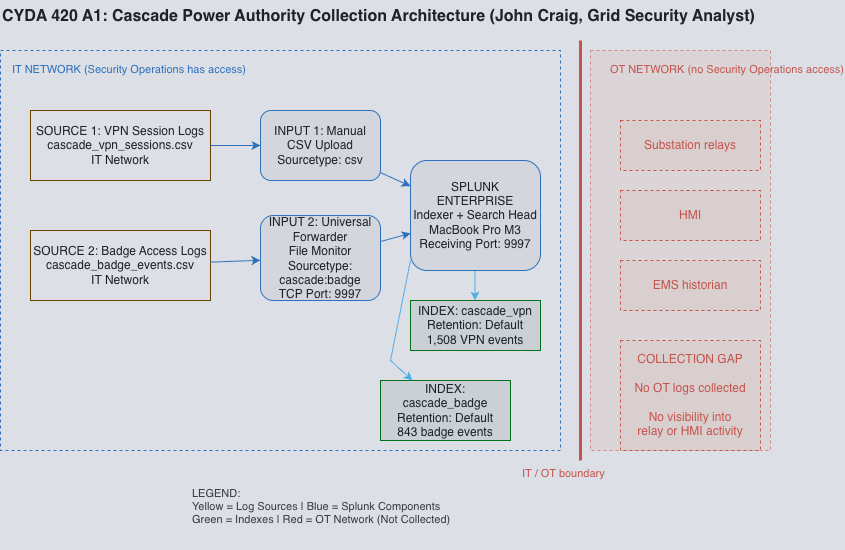
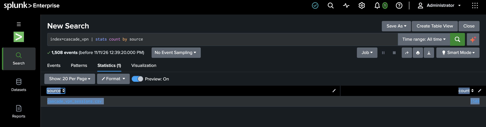
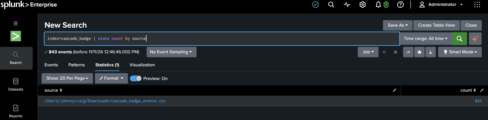

# Lab 01 - Collection Architecture Design

## Overview

For this lab, I worked with Splunk Enterprise to set up log collection for a simulated power utility called Cascade Power Authority. The goal was to understand how security logs are collected and how a SOC can use that information to monitor activity across a network.

I also looked at the differences between monitoring IT and OT environments and identified areas where Cascade could have gaps in its security visibility.

## Lab Environment

- Splunk Enterprise 10.6.1
- Splunk Universal Forwarder
- MacBook Pro (Apple Silicon)
- VPN and physical badge access logs
- Simulated Cascade Power Authority environment

## What I Did

1. Installed and configured Splunk Enterprise on my MacBook.
2. Worked with the Splunk Universal Forwarder and configured receiving on port 9997.
3. Imported and searched VPN and badge access logs.
4. Verified that Splunk could search 1,508 VPN events and 843 badge events.
5. Designed a proposed log collection architecture for Cascade's IT and OT environments.
6. Identified areas where additional monitoring would be needed.

## Challenges

One of the biggest challenges was getting the Splunk Universal Forwarder and indexes configured correctly. I ran into issues where events were not appearing in the expected index and had to troubleshoot the configuration.

This helped me better understand how log forwarding, indexes, and data ingestion work together in Splunk.

## What I Learned

This lab gave me more experience working with Splunk and understanding how security events get from different systems into a central monitoring platform.

I also learned why collecting logs from IT systems alone is not enough for an organization with operational technology. Missing OT logs could make it harder for analysts to identify suspicious activity across the environment.

## Lab Evidence

### 1. Collection Architecture

I created this diagram to show how I collected VPN and badge access logs from Cascade's IT network into Splunk. Each source uses its own index. The diagram also shows the OT network, which wasn't being monitored. This was an important gap because suspicious activity involving substations or other OT equipment wouldn't be visible in my current setup.

### 2. VPN Log Collection

I manually uploaded the VPN session logs into Splunk and stored them in the `cascade_vpn` index. I ran an SPL search to verify that all 1,508 events were available. These logs could help an analyst investigate unusual remote connections or suspicious VPN activity.

### 3. Badge Access Log Collection

I used the Splunk Universal Forwarder to collect badge access logs and send them to Splunk through port 9997. I verified that 843 events were searchable in the `cascade_badge` index. These logs could help identify unusual physical access to Cascade's facilities.
